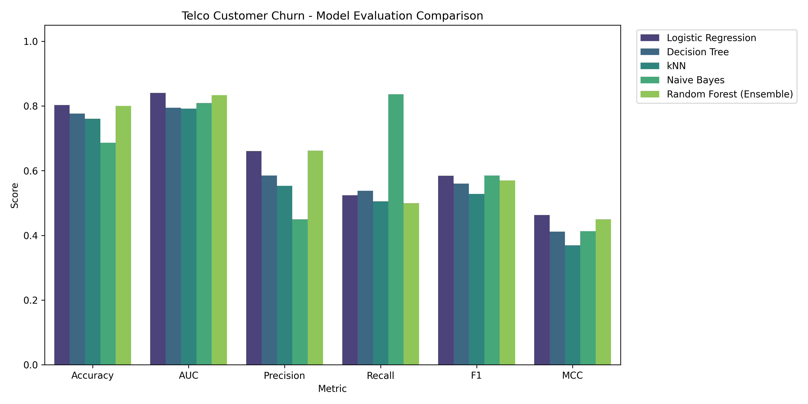

# Telco Customer Churn Prediction — ML Classification Study

## a. Problem Statement
Customer attrition (churn) directly impacts recurring revenue in subscription-based telecommunications businesses. The objective of this project is to build, evaluate, and compare five supervised machine learning classification models to predict whether an existing telecom customer will discontinue their service (`Churn = Yes`) or remain retained (`Churn = No`) based on demographic, account tenure, billing, and subscribed service attributes. Early identification of high-risk customers enables targeted retention interventions.

## b. Dataset Description
* **Dataset Name & Source:** Telco Customer Churn Dataset ([IBM Sample Data / Kaggle Repository](https://www.kaggle.com/datasets/blastchar/telco-customer-churn))
* **Problem Type:** Binary Classification
* **Dataset Dimensions:** 7,043 instances and 19 predictive features (after removing the non-predictive `customerID` identifier column), satisfying the $\ge 1,000$ instances and $\ge 12$ features criteria.
* **Target Variable:** `Churn` (Encoded as `0` for `No` and `1` for `Yes`)
* **Feature Types:**
  * **Numerical Features (4):** `SeniorCitizen`, `tenure`, `MonthlyCharges`, `TotalCharges`
  * **Categorical Features (15):** `gender`, `Partner`, `Dependents`, `PhoneService`, `MultipleLines`, `InternetService`, `OnlineSecurity`, `OnlineBackup`, `DeviceProtection`, `TechSupport`, `StreamingTV`, `StreamingMovies`, `Contract`, `PaperlessBilling`, `PaymentMethod`
* **Missing Values & Duplicates:** Detected 11 missing values in `TotalCharges` (corresponding to brand-new customers with `tenure == 0`) and checked for duplicate records (0 exact duplicates found after dropping `customerID`).
* **Class Distribution & Imbalance:** The target variable exhibits moderate class imbalance: **73.46% `No` (5,174 instances)** vs. **26.54% `Yes` (1,869 instances)**. Because of this ~73:27 skew, Accuracy alone can be misleading, making **ROC-AUC** and **Matthews Correlation Coefficient (MCC)** critical evaluation metrics.
* **Data Preprocessing Pipeline:**
  * Applied a stratified 80:20 train-test split (`5,634` training samples, `1,409` testing samples) with a fixed random seed (`random_state=42`) to preserve exact class proportions.
  * Fitted all transformations strictly on the training set (`X_train`) via `ColumnTransformer` to prevent data leakage: median imputation + `StandardScaler` for numerical features, and most-frequent imputation + `OneHotEncoder(handle_unknown="ignore")` for categorical features.

## c. GitHub Repository Link
* **Repository URL:** [https://github.com/TapaswiniHaldar/tabular-churn-classifier](https://github.com/TapaswiniHaldar/tabular-churn-classifier)

### Execution Instructions
```bash
git clone [https://github.com/TapaswiniHaldar/tabular-churn-classifier.git](https://github.com/TapaswiniHaldar/tabular-churn-classifier.git)
cd tabular-churn-classifier
pip install -r requirements.txt
jupyter notebook telco_churn_classification.ipynb


## d. Models Used & Evaluation Results

### Evaluation Metrics Comparison Table
| ML Model Name | Accuracy | AUC | Precision | Recall | F1 | MCC |
| :--- | :---: | :---: | :---: | :---: | :---: | :---: |
| Logistic Regression | 0.8028 | 0.8403 | 0.6610 | 0.5242 | 0.5847 | 0.4630 |
| Decision Tree | 0.7765 | 0.7945 | 0.5848 | 0.5376 | 0.5602 | 0.4114 |
| kNN | 0.7609 | 0.7921 | 0.5529 | 0.5054 | 0.5281 | 0.3690 |
| Naive Bayes | 0.6861 | 0.8092 | 0.4501 | 0.8360 | 0.5851 | 0.4132 |
| Random Forest (Ensemble) | 0.8000 | 0.8337 | 0.6619 | 0.5000 | 0.5697 | 0.4501 |

### Evaluation Metrics Visualization


### Observations on Model Performance
| ML Model Name | Observation about model performance |
| :--- | :--- |
| **Logistic Regression** | Achieved the strongest overall balanced performance with the highest **Accuracy (0.8028)**, **AUC (0.8403)**, and **MCC (0.4630)**. Standardization of continuous billing features (`tenure`, `MonthlyCharges`, `TotalCharges`) and one-hot encoding allowed its linear decision boundary to separate churners cleanly without overfitting. |
| **Decision Tree** | Delivered moderate predictive power (**Accuracy: 0.7765**, **AUC: 0.7945**, **MCC: 0.4114**). Pruning at `max_depth=8` prevented severe overfitting on the training split, yielding slightly higher Recall (`0.5376`) than Logistic Regression and Random Forest, though lower Precision (`0.5848`). |
| **kNN** | Recorded the lowest **AUC (0.7921)** and **MCC (0.3690)** among all five classifiers. Despite `StandardScaler` normalization, distance-based neighborhood voting suffers from the curse of dimensionality introduced by one-hot encoding 15 categorical features. |
| **Naive Bayes** | Exhibited an aggressive positive-class prediction profile, achieving the highest **Recall (0.8360)** and top **F1 Score (0.5851)**, but the lowest **Accuracy (0.6861)** and **Precision (0.4501)**. The conditional independence assumption across correlated service add-ons causes substantial false positives, though it catches over 83% of actual churners. |
| **Random Forest (Ensemble)** | Ranked a close second overall (**Accuracy: 0.8000**, **AUC: 0.8337**, **MCC: 0.4501**) and achieved the highest **Precision (0.6619)**. Bagging 150 depth-constrained trees (`max_depth=10`) substantially reduced variance compared to the single Decision Tree, boosting MCC from `0.4114` to `0.4501`. |
| **Overall Winner for your dataset?** | **Logistic Regression** is the overall winner for this dataset. On an imbalanced binary classification problem (~73.5% vs. 26.5%), **MCC** and **ROC-AUC** are the most reliable indicators of true discriminative skill, and Logistic Regression led on both (**MCC: 0.4630**, **AUC: 0.8403**) alongside the highest Accuracy (**0.8028**). *(Note: If the business prioritizes catching maximum churners regardless of false alarms, Naive Bayes offers superior Recall at 0.8360).* |
